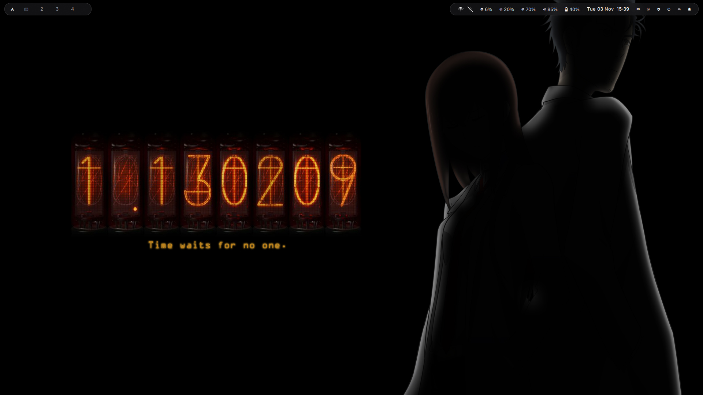
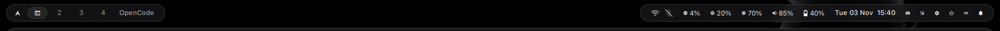
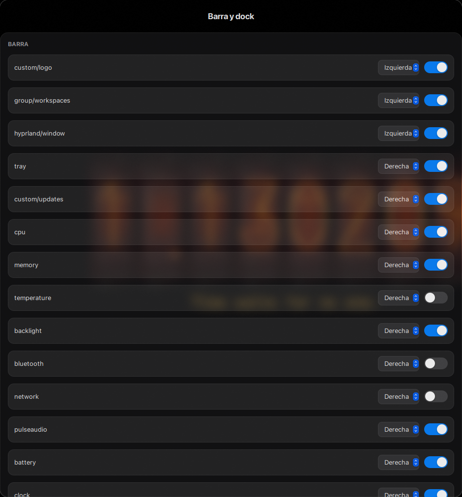

# Glasshouse

Configuración personal de **Arch Linux + Hyprland** con estética macOS/Liquid
Glass. Incluye una sesión Hyprland en Lua, Waybar con panel de ajustes GTK3,
Rofi, Kitty, SwayNC, nwg-dock, Hyprlock/Hypridle, un tema propio de SDDM y una
paleta clara/oscura compartida por todas las piezas.

El repositorio está pensado para vivir en `~/dotfiles`: los scripts de sesión y
el instalador asumen esa ruta.

## Vista previa

**Escritorio** — Hyprland, Waybar superior, dock inferior y paleta oscura.



**Barra** — píldora de workspaces, reloj y módulos de estado.



**Panel de ajustes** — panel GTK3 «Barra y dock».



## Qué incluye

| Componente | Qué aporta |
|---|---|
| Hyprland en Lua | Sesión `session.lua`, configuración base `hyprland.lua` y atajos/servicios en `daily.lua`. Los `.conf` antiguos quedan archivados en `legacy/` y no se cargan. |
| Waybar + panel GTK3 | Barra con píldora de workspaces, reloj, estado y menú de engranaje. `waybar-settings` activa, desactiva y mueve módulos, y controla el dock. |
| Píldora de workspaces | `group/workspaces` muestra un glifo de la ventana activa por workspace; clic enfoca el workspace y, si ya está activo, cicla sus ventanas. |
| Dock | nwg-dock con aplicaciones fijadas, auto-ocultado y escala de iconos al pasar el cursor. |
| Modo gaming | `gaming-toggle` detiene Hypridle e inhibe idle, suspensión y cierre por tapa. |
| Tema claro/oscuro | `theme-toggle` cambia `current.*`, GTK, iconos, Kvantum, Waybar, SwayNC, Kitty y dock desde una sola paleta. |
| Bloqueo y login | Hyprlock/Hypridle, avatar compartido y tema SDDM `glass` con fondo y desenfoque configurables. |
| Scripts | Ajustes, fondos, fuentes, avatar, Waybar, dock, energía, capturas y validación. |

## Instalación rápida

Clona el repositorio en `~/dotfiles` (sustituye el marcador por la URL real):

```bash
git clone <URL-DEL-REPOSITORIO> ~/dotfiles
cd ~/dotfiles
```

Revisa primero el plan y luego aplica los cambios de usuario:

```bash
./install.sh --dry-run --verbose
./install.sh --yes
```

El modo por defecto es **solo a nivel de usuario**: crea enlaces simbólicos,
genera los valores de ejecución que falten (tema actual, `appearance.conf`,
avatar inicial, archivo de apps fijadas del dock) y construye la configuración
de Waybar con `waybar-build`. No usa `sudo`.

> `install.sh` exige que el repo esté en `$HOME/dotfiles`. Si está en otra ruta,
> falla salvo que se pase `--allow-nonstandard`.

### Flags opcionales

Los pasos con privilegios son opt-in:

| Flag | Qué hace | Privilegios |
|---|---|---|
| `--with-session` | Instala `/usr/local/bin/hyprland-glass` y la entrada de sesión `/usr/share/wayland-sessions/hyprland-glass.desktop`. | `sudo` |
| `--with-fonts` | Ejecuta `fonts-install` para instalar SF Pro a nivel de sistema y después `fonts-apply`. Solo si existe `~/.local/share/fonts/San-Francisco-Pro-Fonts-master`. | `sudo` |
| `--with-sddm` | Instala o actualiza el tema SDDM `glass` con `sddm-install`. Modifica `/etc/sddm.conf` y los archivos del tema. | `sudo` |
| `--install-deps` | Instala con `pacman` los paquetes de Arch que falten para los comandos requeridos. Pide confirmación; con `--yes` añade `--noconfirm`. | `sudo` |
| `--allow-nonstandard` | Permite ejecutar el instalador fuera de `~/dotfiles`. Solo para pruebas: los scripts de sesión siguen asumiendo `~/dotfiles`. | — |

Opciones generales: `--dry-run` muestra las acciones sin cambiar nada, `--yes`
omite las confirmaciones y `--verbose` imprime más detalle.

### Backups y desinstalación

Todo lo que `install.sh` reemplaza **bajo `$HOME`** (enlaces simbólicos,
archivos regulares y directorios reales) se copia a:

```text
~/.dotfiles-backup/install-<timestamp>/
```

Ese directorio —y su `manifest.txt` con la relación destino → backup— solo
existe si hubo algo que respaldar. Los enlaces correctos no se tocan; los
enlaces distintos, archivos regulares y directorios reales se respaldan antes de
sustituirse. Los pasos con privilegios no se guardan aquí: usan sus propios
respaldos (ver abajo).

Respaldos de los pasos con privilegios:

- `--with-sddm`: `sddm-install` copia el tema instalado a
  `/var/backups/sddm-themes/glass.<timestamp>` y `/etc/sddm.conf` a
  `/etc/sddm.conf.bak.<timestamp>`.
- `--with-session`: `sudo install` sobrescribe
  `/usr/local/bin/hyprland-glass` y el archivo de sesión de Wayland; no crea
  respaldo en `~/.dotfiles-backup`.

Para deshacer los enlaces de usuario:

```bash
./uninstall.sh --dry-run
./uninstall.sh --yes
```

`uninstall.sh` solo elimina enlaces simbólicos cuyo destino resuelto está dentro
del repositorio y bajo `$HOME`. Después restaura las entradas del manifiesto
cuando el destino está ausente o sigue siendo un enlace al repo. **No** borra
archivos regulares, directorios reales, enlaces ajenos, datos de ejecución del
tema, cachés ni cambios de sistema (SDDM, fuentes, sesión en `/usr/local`).
`uninstall.sh` no revierte esos cambios de sistema. Por defecto usa el backup
`install-*` más reciente; se puede elegir otro con `--backup PATH`.

### Avisos importantes

- **No ejecutes dos instaladores a la vez.** La v1 no tiene un lock global; los
  enlaces y backups podrían pisarse.
- **`install.sh` no escribe ni borra fuera de `$HOME` o del repo.** Antes de
  crear, reemplazar o eliminar una ruta, comprueba que el padre resuelto siga
  bajo `$HOME` o bajo el repo, aunque `~/.config`, `~/.local`, `~/.cache`,
  `~/Pictures` o `~/.dotfiles-backup` sean enlaces simbólicos. Si el padre
  escapa, aborta en lugar de escribir o borrar; `--allow-nonstandard` no
  desactiva esta comprobación. Los enlaces respaldados por el repo, como
  `~/.config/theme -> ~/dotfiles/theme/.config/theme`, siguen permitidos.
- **`--with-sddm` puede afectar al inicio de sesión.** `sddm-install` modifica
  `/etc/sddm.conf` y el tema instalado. Ten una TTY disponible (`Ctrl+Alt+F3`)
  antes de reiniciar. SDDM nunca se reinicia automáticamente.
- **Las fuentes SF Pro y SF Mono no se redistribuyen** por su licencia. El flag
  `--with-fonts` usa una copia local; sin ella, el tema cae en las fuentes de
  respaldo.

## Cómo funciona

La sesión activa usa la configuración del repo, no `~/.config/hypr`:

```text
/usr/local/bin/hyprland-glass
  -> start-hyprland -- -c ~/dotfiles/hypr/.config/hypr/session.lua
```

`hyprland-glass` se instala con `--with-session`. A su vez, `session.lua` carga
`hyprland.lua` (base), que a su vez carga `daily.lua` (atajos y servicios).
`~/.config/hypr` contiene configuraciones HyDE antiguas y no es la configuración
activa: no edites allí esperando cambios en la sesión.

### Mapa de enlaces

| Origen en el repo | Destino |
|---|---|
| `theme/.config/theme` | `~/.config/theme` |
| `nwg-dock-hyprland/.config/nwg-dock-hyprland` | `~/.config/nwg-dock-hyprland` |
| `kitty/.config/kitty/kitty.conf` | `~/.config/kitty/kitty.conf` |
| `fastfetch/.config/fastfetch/config.jsonc` | `~/.config/fastfetch/config.jsonc` |
| `scripts/.local/bin/*` | `~/.local/bin/*` |
| `theme/.local/bin/theme-toggle` | `~/.local/bin/theme-toggle` |
| `wallpapers/Pictures` | `~/Pictures` (si no existe) |
| `wallpapers/Pictures/wallpapers` | `~/Pictures/wallpapers` (si `~/Pictures` ya existe) |

No recrees estos enlaces a mano: `./install.sh --yes` es idempotente y conserva
lo que ya esté correcto.

### Runtime y tema

- `waybar-build` combina `modules.json` y `definitions.json` y genera
  `~/.cache/waybar/config.json`. `waybar-restart` serializa reinicios con
  `flock` y escribe el log en `~/.cache/waybar/waybar.log`.
- `~/.config/theme/mode` guarda el modo activo. `theme-toggle` apunta
  `current.conf`, `current.css`, `current.lua`, `current.rasi` y `current.kitty`
  a `theme/<modo>/colors.*`, y propaga el cambio a GTK, iconos, Waybar, SwayNC,
  Kitty y nwg-dock.
- `~/.config/theme/appearance.conf` guarda fondos, desenfoque, dock y
  auto-ocultado de la barra. Está ignorado por Git.
- `waybar-settings` es un panel GTK3: edita `modules.json` de forma atómica,
  aplica un reinicio de Waybar debounced de ~250 ms y aplica los cambios del dock
  al instante con `dock-restart`. Carga `settings.css` después de
  `~/.config/theme/current.css`.
- Los scripts de `scripts/.local/bin` y `theme/.local/bin` quedan disponibles en
  `~/.local/bin` mediante los enlaces del instalador.

## Cómo se ve

La personalización cotidiana se hace desde el menú de **Ajustes**: botón de
engranaje de Waybar o `SUPER+,`.

- **Tema claro/oscuro:** `theme-toggle` (o `SUPER+T`) alterna la paleta y las
  piezas que la consumen. El lockscreen sigue el modo activo; SDDM se configura
  aparte con `sddm-install dark|light`.
- **Menú de Ajustes:** fondos de escritorio, bloqueo y login; desenfoques; avatar
  de perfil; entrada al panel «Barra y dock» y a las aplicaciones del dock.
- **Panel «Barra y dock»:** una fila por módulo con zona y switch, switch de
  auto-ocultado de la barra y controles del dock (activo, ocultar
  automáticamente o mostrar siempre). La entrada «Aplicaciones del dock» vive
  solo en el menú principal de Ajustes, no en este panel.
- **Modo gaming:** el módulo `custom/gaming` de Waybar alterna el modo y muestra
  el estado con un icono y un tooltip. Detiene Hypridle, inhibe idle, suspensión
  y cierre por tapa, y guarda el estado en
  `${XDG_RUNTIME_DIR}/gaming-mode.state`.
- **Modo bajo consumo:** `low-end-toggle` desactiva blur, sombras, animaciones,
  redondeo y transparencias, y baja el perfil de energía de `performance` a
  `balanced`. Se activa desde Ajustes o por terminal y se recuerda en
  `appearance.conf`.

Las capturas de [Vista previa](#vista-previa) muestran el resultado: escritorio,
barra y panel de ajustes.

## Requisitos

Paquetes principales (Arch):

```text
hyprland hyprlock hypridle waybar swaync nwg-dock-hyprland
rofi kitty sddm qt5-quickcontrols2 qt5-graphicaleffects
imagemagick zenity
jq networkmanager brightnessctl pamixer playerctl grim slurp
wl-clipboard cliphist swaybg
hyprpolkitagent xdg-desktop-portal-hyprland xdg-desktop-portal-gtk
kvantum kvantum-qt5 qt5ct qt6ct
network-manager-applet blueman pacman-contrib libnotify
python-gobject gtk3
systemd util-linux
```

- `waybar-settings` requiere los bindings GTK3 de PyGObject (`python-gobject` +
  `gtk3`).
- `systemd-inhibit` (paquete `systemd`) es necesario para el modo gaming.
- `flock` (paquete `util-linux`) serializa reinicios y toggles.
- `socat` es opcional: permite a `workspace-pill` escuchar eventos de Hyprland;
  sin él usa polling de 1 s.
- `power-profiles-daemon` (`powerprofilesctl`) es opcional: `low-end-toggle` lo
  usa para bajar el perfil de energía.
- Para migrar la configuración: `hyprconf2lua >= 1.7.0` (vía `pipx` o clon
  local).

Fuentes:

- `SF Pro Text`, `SF Pro Display`, `SF Pro Rounded` y `SF Pro`.
- `SF Mono` para la terminal.
- `JetBrainsMono Nerd Font` y `JetBrainsMono Nerd Font Mono`.
- `Inter` sigue instalada como respaldo, pero ya no se referencia en las
  configuraciones.

Criterio tipográfico:

- `SF Pro Text` es la fuente general de interfaz.
- `SF Pro Display` se usa en títulos, reloj, fecha grande y nombres.
- `SF Mono` es la fuente de la terminal (Kitty).
- `JetBrainsMono Nerd Font Mono` sigue como respaldo para los glifos Nerd
  (wifi, batería, iconos) y como monoespaciada de GTK/Qt.

SF Pro y SF Mono no se versionan en el repo. La copia local de SF Pro está en:

```text
~/.local/share/fonts/San-Francisco-Pro-Fonts-master/
```

`SF Mono` está instalada a nivel de usuario en
`~/.local/share/fonts/SF-Mono/` (12 OTFs); su licencia de Apple restringe la
redistribución, así que no se incluye en el repo.

## Servicios opcionales

Glasshouse arranca con una sesión ligera: los servicios que no se usan a diario
quedan desactivados por defecto. `scripts/system/optional-services` los agrupa,
muestra su estado y permite aplicarlos o revertirlos. No se desinstala ningún
paquete y todo cambio es reversible.

Unidades desactivadas por `apply`:

| Unidad | Motivo |
|---|---|
| `bluetooth.service` | Bluetooth es manual; ver `bluetooth-toggle`. |
| `jellyfin.service` | Servidor multimedia bajo demanda; ver `jellyfin-toggle`. |
| `cups.service`, `cups.socket`, `cups.path` | No se usa impresora. |
| `avahi-daemon.service`, `avahi-daemon.socket` | No se usa Chromecast/mDNS. |
| `waydroid-nat.service` | No se usa Waydroid. |
| `libvirtd.service` y sockets de libvirt (`libvirtd*`, `virtlockd*`, `virtlogd*`) | No se usan máquinas virtuales. |
| `NetworkManager-wait-online.service` | No hace falta esperar la red al arrancar. |

Comandos:

```bash
./scripts/system/optional-services status
./scripts/system/optional-services --dry-run apply
sudo ./scripts/system/optional-services apply
sudo ./scripts/system/optional-services revert
```

`status` y `--dry-run` funcionan como usuario; `apply` y `revert` requieren
`sudo`. Las unidades que no están instaladas se omiten.

### Bluetooth y Jellyfin manuales

```bash
~/.local/bin/bluetooth-toggle on|off|toggle|status|manager
~/.local/bin/jellyfin-toggle on|off|toggle|status
```

Bluetooth no arranca applets ni conecta dispositivos automáticamente: `daily.lua`
ya no lanza `blueman-applet` y se activa solo con `bluetooth-toggle on`.
`manager` abre `blueman-manager` o, si no está, `bluetoothctl`. Jellyfin se
inicia bajo demanda y `on` imprime `http://localhost:8096`. Arrancar o parar
estos servicios pide autenticación por Polkit (`pkexec`) si no se ejecuta como
root; `status` funciona sin privilegios.

`obex.service` es un servicio de usuario y `optional-services` no lo gestiona; se
detuvo con:

```bash
systemctl --user stop obex.service
```

También se añadieron overrides `Hidden=true` en `~/.config/autostart/` para
arch-update-tray, blueman, baloo_file, geoclue-demo-agent, orca-autostart,
print-applet, polkit-kde-authentication-agent-1 y xdman.

### Reversión

```bash
sudo ./scripts/system/optional-services revert
```

Después, si hace falta, borrar los overrides `~/.config/autostart/*.desktop` y
volver a arrancar el servicio de usuario:

```bash
systemctl --user start obex.service
```

No se elimina ningún paquete. VirtualBox no se toca: se instala o desinstala a
mano y `virtvboxd` ya está desactivado.

## Estructura del repositorio

| Ruta | Contenido |
|---|---|
| `hypr/` | Sesión y configuración de Hyprland en Lua, más `hyprlock.conf`, `hypridle.conf` y los `.conf` archivados en `legacy/`. |
| `waybar/` | `style.css`, `settings.css`, `modules.json` y `definitions.json`. |
| `theme/` | Paletas `dark/` y `light/`, avatares base y `theme-toggle`. |
| `rofi/` | Lanzador y menú de energía. |
| `kitty/` | Configuración de la terminal. |
| `swaync/` | Estilos de notificaciones. |
| `nwg-dock-hyprland/` | Estilos del dock. |
| `sddm/glass/` | Tema del greeter (QML, `theme.conf` e iconos). |
| `scripts/` | Scripts de sesión, ajustes, Waybar, dock, fuentes, avatar y energía. |
| `scripts/system/` | Servicios opcionales (`optional-services`). |
| `wallpapers/` | Fondos de ejemplo. |
| `fastfetch/` | Configuración de Fastfetch. |
| `docs/screenshots/` | Capturas usadas en este README. |
| `install.sh` | Instalador v1: enlaces, runtime, Waybar y flags privilegiados opt-in. |
| `uninstall.sh` | Elimina solo enlaces al repo y restaura backups del instalador. |
| `hypr-lua-migrate.sh` | Migración de Hyprland a Lua y archivado de los `.conf`. |

## Solución de problemas

### Waybar no aparece

Comprueba el proceso, las capas de Wayland y el log:

```bash
pgrep -x waybar
hyprctl layers | grep -A2 'namespace: waybar'
cat ~/.cache/waybar/waybar.log
```

Si no está, reiníciala:

```bash
~/.local/bin/waybar-restart
```

`waybar-restart` vacía el log en cada reinicio. Los mensajes
`waybar-restart: timed out waiting for waybar layer` y
`waybar-restart: waybar exited during startup` indican que los daemons de
workspaces y auto-ocultado no se iniciaron.

### El panel de ajustes no abre

```bash
~/.local/bin/waybar-settings
```

Requiere PyGObject con GTK3 (`python-gobject` + `gtk3`). Si falla, revisa esas
dependencias. La entrada «Aplicaciones del dock» está en el menú principal de
Ajustes (`settings-menu`), no en el panel.

### El modo gaming no responde

```bash
~/.local/bin/gaming-toggle on
~/.local/bin/gaming-toggle off
~/.local/bin/gaming-toggle toggle
cat "${XDG_RUNTIME_DIR}/gaming-mode.state"
```

El estado se guarda en `${XDG_RUNTIME_DIR}/gaming-mode.state`. Necesita
`systemd-inhibit` (paquete `systemd`) y `flock` (paquete `util-linux`). Si
`systemd-inhibit` no está disponible, `gaming-toggle` desactiva Hypridle y avisa
de que el inhibidor no pudo iniciarse.

### SDDM

Si el login no se ve como esperas, no reinicies SDDM a ciegas: cambia a una TTY
(`Ctrl+Alt+F3`), revisa `/etc/sddm.conf` y los backups de `sddm-install`, y
consulta el journal:

```bash
journalctl -u sddm -b --no-pager | grep -Ei 'theme|qml|error|warning' | tail -50
```

`--with-sddm` nunca reinicia SDDM; el greeter real solo se ve tras reiniciar el
equipo o el servicio de forma manual y consciente.

## Ajustes de apariencia

El menú de Ajustes se abre desde el botón de engranaje de Waybar o con `SUPER+,`
(`scripts/.local/bin/settings-menu`). Entradas:

| Entrada | Qué hace |
|---|---|
| Fondo de escritorio | Abre `wallpaper-select` (también `SUPER+SHIFT+W`). |
| Avatar de perfil | Abre `avatar-select` en una terminal (puede pedir `sudo`). |
| Fondo de la pantalla de bloqueo | Igual que el escritorio, una imagen de la carpeta de wallpapers u otra imagen. |
| Fondo del inicio de sesión | Igual, y sincroniza SDDM con `sddm-install` (pide `sudo`). |
| Desenfoque del bloqueo | Activa o desactiva el desenfoque del fondo de hyprlock. |
| Desenfoque del inicio de sesión | Activa o desactiva el desenfoque del fondo de SDDM y sincroniza (pide `sudo`). |
| Barra y dock | Abre el panel GTK3 `waybar-settings`: módulos de la barra, auto-ocultado y ajustes del dock. |
| Aplicaciones del dock | Abre `dock-settings`: añade o quita apps fijadas de nwg-dock. Esta entrada vive solo en el menú principal de Ajustes. |
| Modo bajo consumo | Activa o desactiva `low-end-toggle`: menos efectos y perfil de energía más ligero. |

El panel «Barra y dock» (`waybar-settings`, GTK3) tiene dos secciones:

- **Barra**: una fila por módulo con selector de zona (Izquierda/Centro/Derecha)
  y switch activado/desactivado, más un switch para el auto-ocultado de la barra.
- **Dock**: switch «Dock activo» y radios «Ocultar automáticamente»/«Mostrar
  siempre». Con el dock desactivado, los radios siguen visibles pero
  deshabilitados. La entrada «Aplicaciones del dock» vive solo en el menú
  principal de Ajustes; el panel no repite ese botón.

Visualmente, el panel es una única superficie continua: la ventana aporta el
fondo y el borde, mientras que el header y los contenedores (`headerbar`,
`scrolledwindow`, `viewport`, `.settings-surface`) son transparentes. Solo las
filas (`.setting-row`) se dibujan como tarjetas internas.

El panel guarda `modules.json` de forma atómica, aplica los cambios con un
reinicio de Waybar debounced de ~250 ms y, si se cierra con un reinicio pendiente,
lo ejecuta una sola vez. Los cambios de dock se aplican al instante con
`dock-restart`. El panel carga `waybar/.config/waybar/settings.css` después de
`~/.config/theme/current.css`.

Los ajustes se guardan en `~/.config/theme/appearance.conf` (ignorado por Git) con
`appearance get|set`:

| Clave | Valores | Por defecto |
|---|---|---|
| `wallpaper_dir` | ruta de una carpeta | `~/Pictures/wallpapers` |
| `lock_bg` | `desktop` o ruta de una imagen | `desktop` |
| `lock_blur` | `on` / `off` | `off` |
| `sddm_bg` | `desktop` o ruta de una imagen | `desktop` |
| `sddm_blur` | `on` / `off` | `on` |
| `dock_enabled` | `on` / `off` | `on` |
| `dock_autohide` | `on` / `off` | `on` |
| `bar_autohide` | `on` / `off` | `off` |
| `low_end` | `on` / `off` | `off` |

`wallpaper_dir` es la raíz del selector de fondos. Cada subcarpeta directa que
contiene imágenes se trata como una categoría, y las categorías nuevas se
detectan automáticamente al abrir el menú.

Con `desktop`, el bloqueo usa siempre el wallpaper actual
(`~/.cache/current-wallpaper`). SDDM usa el wallpaper que había al ejecutar
`sddm-install`, así que se actualiza al sincronizar.

Las imágenes elegidas con «Otra imagen…» se copian a
`~/.config/theme/backgrounds/` (ignorada por Git), para que el ajuste no se rompa
si se borra el original.

Scripts implicados:

- `appearance`: lee y escribe `appearance.conf`.
- `appearance-wall lock|sddm`: imprime la ruta del fondo que corresponde, con
  respaldo a `~/Pictures/wallpapers/wall.jpg`.
- `bar-autohide`: oculta Waybar cuando el cursor baja del borde superior y la
  muestra al volver a `y <= 4`; se controla con `bar_autohide` desde el panel.
- `waybar-settings`: panel GTK3 «Barra y dock»; edita `modules.json` y los
  ajustes de barra/dock.
- `dock-restart`: lee `dock_enabled` y `dock_autohide` y (re)inicia nwg-dock.
- `dock-settings`: añade o quita clases de `~/.cache/nwg-dock-pinned`.
- `lock-screen`: usa `appearance-wall lock` y aplica `lock_blur`.
- `sddm-install`: usa `appearance-wall sddm` y escribe `blur=` en `theme.conf`.

Desde la terminal:

```bash
~/.local/bin/appearance set lock_blur on
~/.local/bin/appearance get lock_blur off
~/.local/bin/appearance-wall lock
```

### Wallpapers por categorías

`wallpaper-pick` (`~/.local/bin/wallpaper-pick`) es el selector Rofi en dos pasos
que comparten el escritorio, el bloqueo y el login:

1. **Categorías:** subcarpetas directas de `wallpaper_dir` que contienen al menos
   una imagen, más «Todas las imágenes» y, si hay imágenes sueltas en la raíz,
   «Sin categoría».
2. **Imágenes de la categoría elegida.** Dentro de una categoría la búsqueda es
   recursiva; en «Sin categoría» solo se listan los archivos de la raíz.

- Las categorías nuevas se detectan solas: basta con crear una subcarpeta con
  imágenes.
- Extensiones admitidas: `.jpg`, `.jpeg`, `.png` y `.webp`.
- `--desktop` añade «Igual que el escritorio»; `--custom` añade «Otra imagen…»
  (la copia a `~/.config/theme/backgrounds/`); `--prompt TEXTO` cambia el título
  del menú.

`wallpaper-select` usa `wallpaper-pick` y guarda la elección en
`~/.cache/current-wallpaper`. `wallpaper-select restore` valida esa caché y, si
la ruta ya no existe, cae a `wallpaper_dir/wall.jpg` o a la primera imagen
encontrada.

`settings-menu` usa el mismo helper para «Fondo de la pantalla de bloqueo» y
«Fondo del inicio de sesión», conservando «Igual que el escritorio» y «Otra
imagen…». El fondo de escritorio sigue disponible con `SUPER+SHIFT+W`.

```bash
~/.local/bin/appearance set wallpaper_dir "$HOME/Descargas/Super PACK Wallpaper By Settings PC/Super PACK Wallpaper By Settings PC"
~/.local/bin/wallpaper-select
~/.local/bin/wallpaper-pick --desktop --custom --prompt "Fondo de bloqueo"
```

El pack externo tiene un nivel duplicado. Hay que apuntar `wallpaper_dir` al
nivel interno, el que contiene `Aesthetic/`, `Mac OS/`, `MINIMALISTA/` y
`Windows/`; el nivel externo no agrupa esas carpetas como categorías.

## Modo bajo consumo

`low-end-toggle` es un perfil opcional para equipos con poca GPU. Al activarlo:

- desactiva blur, sombras, animaciones, redondeo y transparencias en Hyprland;
- si el perfil de energía actual es `performance`, lo baja a `balanced` y guarda
  el anterior para restaurarlo;
- recuerda el estado en `appearance.conf` (`low_end=on`) y lo reaplica al
  iniciar sesión y después de `hyprctl reload` desde `theme-toggle`.

```bash
~/.local/bin/low-end-toggle on
~/.local/bin/low-end-toggle off
~/.local/bin/low-end-toggle toggle
~/.local/bin/low-end-toggle status
```

Se usa desde Ajustes o con `hyprctl eval` (Hyprland 0.57 usa Lua; `hyprctl
keyword` ya no aplica estos cambios). No toca VRR ni desinstala paquetes. El
perfil de energía solo se modifica si `powerprofilesctl` está disponible.

## Fuentes

### Sesión de usuario

`fonts-apply` aplica las fuentes en la sesión y guarda backups con sufijo
`.bak.<fecha>`:

```bash
~/.local/bin/fonts-apply
```

Cambios que aplica:

- `gsettings`:
  - `font-name = SF Pro Text 10`
  - `document-font-name = SF Pro Text 10`
  - `monospace-font-name = JetBrainsMono Nerd Font Mono 10`
  - `titlebar-font = SF Pro Display 11`
- `~/.config/gtk-3.0/settings.ini`:
  - `gtk-font-name=SF Pro Text 10`
- `~/.config/gtk-4.0/settings.ini`:
  - `gtk-font-name=SF Pro Text 10`
- `~/.config/qt5ct/qt5ct.conf` y `~/.config/qt6ct/qt6ct.conf`:
  - `general` usa `SF Pro Text`.
  - `fixed` usa `JetBrainsMono Nerd Font Mono`.

GTK3/GTK4 solo admiten `gtk-font-name` en `settings.ini`; no se añade
`gtk-monospace-font-name` porque GTK lo rechaza con un warning. La fuente
monoespaciada se aplica vía `gsettings` y vía Qt.

### SDDM

El greeter corre como el usuario `sddm`, así que no ve las fuentes de
`~/.local/share/fonts`. Para que el tema glass use SF Pro de verdad hay que
instalarlas a nivel de sistema:

```bash
~/.local/bin/fonts-install
```

El script copia los 47 archivos `.otf`/`.ttf` del master de SF Pro a:

```text
/usr/local/share/fonts/sf-pro/
```

Después ejecuta `fc-cache -f` y verifica la resolución como usuario y como
`sddm`:

```bash
sudo -u sddm fc-match -f '%{family} | %{style} | %{file}\n' "SF Pro Text"
```

No se borra ninguna fuente existente. El duplicado
`~/.local/share/fonts/SF Pro Display` se deja intacto; contiene 9 estilos que
también están en el master. `fc-match` puede elegir ese duplicado, pero ambos
son válidos.

## Lockscreen

El bloqueo se lanza con (`SUPER+L`, el panel de energía o `hypridle`):

```bash
~/.local/bin/lock-screen
```

`lock-screen` genera `~/.cache/hyprlock-run.conf` sustituyendo `@WALL@` por el
fondo elegido (`appearance-wall lock`), `@STATUS@` por el estado de `lock-info` y
`@AVATAR_BLOCK@` por el bloque del avatar, y luego ejecuta `hyprlock` con ese
archivo. No editar el archivo de caché; editar
`hypr/.config/hypr/hyprlock.conf` y volver a bloquear.

Cambios realizados:

- El texto de estado usa `JetBrainsMono Nerd Font Mono` mediante
  `$font_icons`.
- El glifo wifi `U+F05A9` de la variante no Mono tiene más tinta que avance
  (`advance=600`, `ink.xMax=898`), y hyprlock recortaba el extremo. La variante
  Mono tiene overhang 0, así que el icono se ve completo.
- La hora usa `SF Pro Display` con Pango
  `<span font_weight="600">$TIME</span>`. Hyprlock no expone `font_weight` como
  opción, así que el peso se selecciona con markup. Antes `Inter Bold` podía
  caer en una fuente de respaldo.
- Fecha, inicial, nombre y ayuda usan `SF Pro Display`/`SF Pro Text` según el
  tamaño y el rol.
- El campo de contraseña usa `$font_ui`.
- El lockscreen sigue el tema claro/oscuro con variables de `colors.conf`:
  `$text`, `$subtext`, `$bg`, `$border_active`, `$accent`, `$red`, `$shadow` y
  `$lock_bg_brightness`.
- El fondo es una imagen (`@WALL@`), no una captura del escritorio. Por defecto
  es el wallpaper actual, o el que se haya elegido en Ajustes (`lock_bg`).
- El desenfoque se controla desde Ajustes (`lock_blur`). `lock-screen` borra las
  líneas `blur_passes`/`blur_size` del bloque `background` del archivo generado
  y escribe `blur_passes = 0` (desactivado, valor por defecto) o `blur_passes = 3`
  con `blur_size = 7` (activado). La plantilla no se toca.
- El avatar se genera en `@AVATAR_BLOCK@`: imagen de 80 px si
  `avatar_mode=image`, o círculo con inicial si no hay imagen válida.
  La imagen se toma de `~/.config/theme/avatar.conf`/`avatar.png`.

Variables añadidas a `theme/.config/theme/{dark,light}/colors.conf`:

```text
$font_ui = SF Pro Text
$font_display = SF Pro Display
$font_icons = JetBrainsMono Nerd Font Mono
$lock_bg_brightness = 0.85   # dark
$lock_bg_brightness = 1.0    # light
$shadow = rgba(00000066)     # dark
$shadow = rgba(00000033)     # light
$red = rgba(ff453aff)        # dark
$red = rgba(d70015ff)        # light
```

`lock-info` se versiona con el repo y es requerido por `lock-screen`.

## Avatar de perfil

El avatar se comparte entre el lockscreen y SDDM. Hay dos modos:

- `initials`: círculo con la inicial del nombre del usuario.
- `image`: imagen circular, recortada y normalizada a 512x512.

Avatares base versionados en:

```text
theme/.config/theme/avatars/
  aurora.png
  forest.png
  midnight.png
  sunset.png
```

Selección interactiva (también desde Ajustes, «Avatar de perfil»):

```bash
~/.local/bin/avatar-select
```

El menú ofrece `Iniciales`, los avatares base, los avatares propios de
`avatars/custom/` (con el sufijo `(propio)`) e `Imagen personalizada…`. Cada
entrada se resuelve a su ruta completa, así que un nombre repetido en `avatars/` y
`custom/` no se confunde. La imagen personalizada se elige con Zenity y se recorta
al centro con ImageMagick.

También se puede usar sin menú:

```bash
~/.local/bin/avatar-select initials
~/.local/bin/avatar-select set ~/Pictures/mi-foto.jpg
~/.local/bin/avatar-select --no-sddm set ~/Pictures/mi-foto.jpg
```

La selección se guarda en `~/.config/theme/avatar.conf` y la copia de trabajo
en `~/.config/theme/avatar.png`. Ambos están ignorados por Git:

```text
avatar_mode=image
avatar_image=/home/shadow/.config/theme/avatar.png
```

El lockscreen lee ese archivo al bloquear. Para SDDM, `avatar-select` intenta
sincronizar con `sddm-install` (pide `sudo`); si se usa `--no-sddm`, hay que
ejecutar:

```bash
~/.local/bin/sddm-install dark
```

`sddm-install` copia `avatar.png` al tema, escribe `avatarMode`/`avatar` en
`theme.conf` y conserva el modo `initials` si no hay imagen válida. El avatar
no se versiona; solo se versionan las imágenes base.

Para añadir una imagen propia al menú sin versionarla, guardarla en
`~/.config/theme/avatars/custom/` (ignorada por Git). Los avatares base de
`avatars/` sí se versionan. La copia de trabajo seguirá siendo
`~/.config/theme/avatar.png` (ignorada).

## SDDM

El tema está en `sddm/glass` y se instala en
`/usr/share/sddm/themes/glass` con:

```bash
~/.local/bin/sddm-install dark
```

`--with-sddm` ejecuta este paso con `sudo` tras pedir confirmación. SDDM no se
reinicia automáticamente.

### Causa del tema anterior

En esta versión de SDDM el orden de precedencia es:

```text
/usr/lib/sddm/sddm.conf.d
  -> /etc/sddm.conf.d
  -> /etc/sddm.conf        (último, mayor prioridad)
```

`/etc/sddm.conf` contenía `Current=sddm-astronaut-theme`, así que anulaba
`/etc/sddm.conf.d/zz-glass.conf` (`Current=glass`). El journal confirmaba la
carga de `sddm-astronaut-theme/Themes/cyberpunk.conf`.

`fonts-apply`/`sddm-install` no eliminan el tema anterior. `sddm-install`:

- Hace backup del tema instalado en
  `/var/backups/sddm-themes/glass.<fecha>`.
- Copia el tema del repo sin `rm -rf`.
- Copia el fondo elegido (`appearance-wall sddm`) como `background.<ext>`.
- Copia el avatar seleccionado como `avatar.png`, si existe.
- Actualiza `background`, `mode`, `avatarMode`, `avatar` y `blur` en
  `theme.conf`. `blur` sale de `sddm_blur` (`on` por defecto).
- Hace backup de `/etc/sddm.conf` y fija `Current=glass`.
- Hace backup de `/etc/sddm.conf.d/the_hyde_project.conf` y cambia su
  `Current=Candy` por `Current=glass`.
- Mantiene `zz-glass.conf` como está.
- Comprueba si el usuario `sddm` resuelve `SF Pro Text` y avisa si falta
  `fonts-install`.
- No reinicia SDDM; hay que reiniciar el equipo para ver el greeter real.

`/etc/sddm.conf` es el archivo de mayor prioridad. El tema
`sddm-astronaut-theme` sigue instalado, pero ya no se selecciona.

En esta versión, `sddm --example-config` imprime la configuración por defecto y
no refleja la combinación de `/etc/sddm.conf*`. Para verificar el tema real:

```bash
journalctl -u sddm -b --no-pager | grep -Ei 'theme|qml|error|warning' | tail -50
```

Se espera una línea de carga de
`/usr/share/sddm/themes/glass/theme.conf`.

### Claves de `theme.conf`

- `background`: imagen de fondo, copiada junto al tema.
- `mode`: `dark` o `light`; el menú del greeter («?») permite cambiarlo solo para
  esa sesión.
- `font` y `fontDisplay`: `SF Pro Text` y `SF Pro Display`.
- `clock`: `bar` (píldora arriba a la derecha) o `big` (reloj grande).
- `avatarMode` y `avatar`: `initials` o `image`, y la imagen.
- `blur`: `on` u `off`. Si falta, el fondo se desenfoca.

### Fuentes del tema

- `sddm/glass/theme.conf`:
  - `font=SF Pro Text`
  - `fontDisplay=SF Pro Display`
- `sddm/glass/Main.qml`:
  - `root.fam` usa `SF Pro Text` para interfaz, contraseña, sesión, energía y
    menú.
  - `root.famDisplay` usa `SF Pro Display` para reloj, fecha grande, nombre e
    inicial.
  - Si `config.fontDisplay` no está expuesto, el fallback es `SF Pro Display`.
  - `hasAvatar` muestra `config.avatar` en un círculo con `OpacityMask` cuando
    `avatarMode=image`; si no, muestra la inicial.
  - Es compatible con Qt5: `import QtQuick 2.15`,
    `import QtQuick.Controls 2.15` e `import QtGraphicalEffects 1.0`.
  - El fondo usa `FastBlur` de QtGraphicalEffects; no usa `QtQuick.Effects`
    ni `MultiEffect`, que son Qt6. Su `radius` es 0 si `config.blur` vale `off`
    y 64 en cualquier otro caso.

El paquete `sddm 0.21.0-8` de CachyOS lanza `/usr/bin/sddm-greeter`, que está
enlazado contra Qt5, no `sddm-greeter-qt6`. Por eso el tema debe usar imports
con versión. El error:

```text
Library import requires a version
```

aparece cuando un greeter Qt5 carga `import QtQuick` sin versión. La prueba
anterior con `sddm-greeter-qt6` no representaba al greeter real.

Prueba visual sin tocar el sistema:

```bash
TMP="$(mktemp -d)"
cp -r ~/dotfiles/sddm/glass/. "$TMP/"
cp ~/Pictures/wallpapers/332314.jpg "$TMP/background.jpg"
sed -i 's|^background=.*|background=background.jpg|' "$TMP/theme.conf"
sddm-greeter --test-mode --theme "$TMP"
```

El test mode corre como el usuario actual; no demuestra por sí solo que el
usuario `sddm` vea SF Pro ni lea el avatar. Para eso está `fonts-install` y la
verificación con `sudo -u sddm`.

Si el tema ya estaba instalado antes de corregir el QML, volver a copiarlo y
reiniciar:

```bash
~/.local/bin/sddm-install dark
systemctl reboot
```

## Waybar

Archivo: `waybar/.config/waybar/style.css`.

- Fuente global: `"SF Pro Text", "JetBrainsMono Nerd Font Mono"`.
- `#clock`: `SF Pro Text`, peso 500.
- `#window`: `SF Pro Text`, peso 500.
- `group/workspaces` agrupa `custom/ws1`…`custom/ws4`: cada workspace muestra
  un único glifo de su ventana activa, o su número si está vacío, con píldora
  de ancho fijo. Los módulos custom solo pueden usar glifos Nerd Font, no
  iconos GTK; el mapa de clases está en
  `scripts/.local/bin/workspace-pill`. Click enfoca el workspace y, si ya está
  activo, cicla sus ventanas. `waybar-restart` inicia `workspace-pill daemon`,
  que escucha `.socket2.sock` de Hyprland y actualiza los cuatro módulos con
  `SIGRTMIN+8` solo cuando cambia el estado; sin `socat` cae a polling de 1 s.
  Se mantiene `hyprland/window` para el título.
- Los iconos Nerd usan el fallback Mono.
- El resto de módulos heredan la fuente global.
- `bar-autohide` oculta la barra con `SIGUSR1` cuando el cursor baja de
  `y = 48` y la muestra al acercarse al borde superior. Se activa con el switch
  «Ocultar barra automáticamente» del panel `waybar-settings` o con
  `appearance set bar_autohide on` + `waybar-restart`.

La configuración se genera con:

```bash
~/.local/bin/waybar-build
~/.local/bin/waybar-restart
```

`waybar-build` combina `modules.json` y `definitions.json` en
`~/.cache/waybar/config.json`. La lista `disabled` de `modules.json` es
`[temperature, bluetooth, network]`. Para reducir wakeups, `cpu` y `memory`
usan intervalos de 10 s, y `custom/updates` de 6 h; el resto de módulos usan
eventos o intervalos propios.

`waybar-restart` usa `flock` para serializar reinicios y escribe la salida de
Waybar en `~/.cache/waybar/waybar.log`. Antes de lanzar `bar-autohide` y
`workspace-pill daemon`, espera a que `hyprctl layers` muestre el namespace
`waybar`; así el primer `SIGRTMIN+8` de `workspace-pill` no llega antes de que
Waybar instale su manejador de señales en un arranque en frío. Si Waybar termina
o no llega a mapearse, el script sale con código 1 e indica el log, sin iniciar
los daemons.

El botón de engranaje (`custom/settings`) abre `settings-menu`. El módulo
`custom/wallpaper` ya no está en la barra: el cambio de fondo está en Ajustes y
en `SUPER+SHIFT+W`. La entrada «Barra y dock» de Ajustes abre el panel GTK3
`waybar-settings`, que activa, desactiva y mueve módulos entre zonas, controla el
auto-ocultado de la barra y los ajustes del dock. El panel usa
`waybar/.config/waybar/settings.css`, cargado después de
`~/.config/theme/current.css`.

En la zona derecha, entre `custom/power` y `custom/notifications`, está
`custom/gaming`. El módulo ejecuta `gaming-status`, que imprime el JSON de Waybar
(icono, clase `on`/`off` y tooltip). Al hacer clic llama a `gaming-toggle` y envía
`SIGRTMIN+9` a Waybar para refrescar el estado.

`gaming-toggle` activa o desactiva el modo gaming. Al activarlo detiene `hypridle`
y mantiene un inhibidor
`systemd-inhibit --what=idle:sleep:handle-lid-switch`, de modo que quedan
desactivados idle, bloqueo, suspensión y el cierre por tapa. El estado se guarda
en `${XDG_RUNTIME_DIR}/gaming-mode.state`. Al desactivarlo libera el inhibidor y
vuelve a lanzar
`hypridle -c ~/dotfiles/hypr/.config/hypr/hypridle.conf`.

El botón es idempotente y los cambios se serializan con `flock`, así que pulsarlo
varias veces no duplica inhibidores. Los alias antiguos de terminal siguen
existiendo, pero la barra usa el wrapper `gaming-toggle`.

## SwayNC

Archivo: `swaync/.config/swaync/style.css`.

- Fuente global: `"SF Pro Text", "JetBrainsMono Nerd Font Mono"`.
- `.widget-title`: `SF Pro Text`.
- `.summary`: mantiene `font-weight: 600`.
- Los glifos Nerd caen en la Mono.

Recargar:

```bash
swaync-client -rs
```

## Rofi

Archivos: `rofi/.config/rofi/config.rasi` y `power.rasi`.

- Lanzador: `font: "SF Pro Text 13"`.
- Menú de energía: `font: "SF Pro Text 13"`; cada opción muestra un icono de
  44 px y una etiqueta `SF Pro Text 10` debajo, dentro de un botón circular
  (`border-radius: 52px`) en una fila de 6 columnas.
- `power-menu` usa `SF Pro Text 13` para el mensaje de confirmación; la opción
  `Cancelar` usa el tamaño compacto de 10 px definido en `power.rasi`.
- El menú de energía activa `hover-select`, `me-select-entry: ""` y
  `me-accept-entry: "MousePrimary"` en `power.rasi`. Así, al pasar el cursor la
  opción queda seleccionada y un solo clic la activa, tanto en el menú principal
  como en la confirmación.
- El `icon-theme` sigue fijado a `WhiteSur-dark`; no se cambió en esta fase.
  Es una inconsistencia conocida con `theme-toggle`, que usa
  `WhiteSur-glass`/`WhiteSur-glass-light`.
- `settings-menu`, `avatar-select`, `wallpaper-select` y `dock-settings`
  reutilizan `config.rasi`. `waybar-settings` es un panel GTK3 y no usa Rofi.
- En `power.rasi`, el elemento seleccionado solo cambia de color y borde de
  acento; el tamaño se mantiene para evitar saltos de layout. Rofi no soporta
  transiciones ni escalado de iconos; el aumento real solo se aplica a los
  iconos del dock.

Probar:

```bash
rofi -show drun -config ~/dotfiles/rofi/.config/rofi/config.rasi
~/.local/bin/power-menu
rofi -dump-theme -config ~/dotfiles/rofi/.config/rofi/power.rasi >/dev/null
```

## nwg-dock, Kitty y Hyprland

- nwg-dock declara `SF Pro Text` con fallback Nerd Font en su CSS; no depende
  de `gtk-font-name`.
- Las apps fijadas se guardan como clases, una por línea, en
  `~/.cache/nwg-dock-pinned` (`kitty`, `firefox`, …). «Aplicaciones del dock»
  en Ajustes abre `dock-settings` para añadirlas o quitarlas.
- `dock_enabled` (`on` por defecto) decide si el dock se lanza; `dock_autohide`
  (`on` por defecto) controla el flag `-d`. `dock-restart` lee ambos de
  `appearance.conf`: si `dock_enabled=off`, mata el dock y sale sin relanzarlo.
  Usa `flock` para serializar toggles rápidos.
- Al pasar el cursor, los iconos del dock se amplían con
  `-gtk-icon-transform: scale(1.18)` y una transición de 180 ms.
- Kitty usa `SF Mono` tamaño 11, con `background_opacity 0.82`,
  `window_padding_width 16` y decoraciones ocultas. La configuración activa es
  `~/dotfiles/kitty/.config/kitty/kitty.conf`, enlazada como
  `~/.config/kitty/kitty.conf`. Las pestañas van abajo solo con 2+ pestañas, con
  estilo powerline inclinado y título `índice: título · nº ventanas`.
  `symbol_map` reserva los rangos Nerd Font a `JetBrainsMono Nerd Font Mono`;
  el resto del texto usa SF Mono. La paleta se incluye al final desde
  `~/.config/theme/current.kitty`.
- Hyprland no dibuja títulos de ventana. Los títulos visibles los pinta Waybar
  con `SF Pro Text`; las apps GTK/Qt usan `fonts-apply`.
- Las ventanas usan `windowsIn = popin 92%` y `windowsOut = gnomed` (efecto
  lámpara mágica) con la curva `ease`.

Recargar el dock:

```bash
~/.local/bin/dock-restart
```

## Fastfetch

Archivo: `fastfetch/.config/fastfetch/config.jsonc`, enlazado como
`~/.config/fastfetch/config.jsonc` por `install.sh`.

Si necesitas recrear el enlace a mano (fallback de `install.sh`):

```bash
ln -sfn ~/dotfiles/fastfetch/.config/fastfetch/config.jsonc ~/.config/fastfetch/config.jsonc
```

- Logo de Arch (`small`) con padding superior y derecho.
- Claves alineadas a 13 columnas y separador de dos espacios.
- Colores ANSI tomados de la paleta de Kitty (`~/.config/theme/current.kitty`);
  por eso siguen el tema claro/oscuro. `bright_blue` se usa para claves y
  título.
- Módulos: `title`, `OS`, `Kernel`, `Packages`, `Shell`, `WM`, `Terminal`,
  `Display`, `CPU`, `GPU`, `Memory`, `Disk` y `Uptime`.
- No usa las cajas de HyDE.

Validar que la configuración explícita y la del symlink producen la misma
salida:

```bash
fastfetch --config ~/dotfiles/fastfetch/.config/fastfetch/config.jsonc --pipe false
fastfetch --pipe false
```

Ambos comandos deben terminar con código 0, sin stderr y con la misma salida.

## Tema claro/oscuro

`theme-toggle` cambia los symlinks `current.conf`, `current.lua`, `current.css`,
`current.rasi` y `current.kitty`, además de GTK, iconos, Kvantum, Waybar,
SwayNC, Kitty y nwg-dock:

```bash
~/.local/bin/theme-toggle        # alterna
~/.local/bin/theme-toggle dark
~/.local/bin/theme-toggle light
```

El lockscreen sigue el modo porque lee `~/.config/theme/current.conf`.
Hyprland lee los colores desde `~/.config/theme/current.lua`.
SDDM es independiente: su modo se define en `sddm/glass/theme.conf` y se puede
cambiar con `sddm-install dark|light` o desde el menú del greeter (solo para esa
sesión).

Pendientes conocidos de integración visual, no tocados en esta fase:

- Rofi fija `WhiteSur-dark` y no sigue el modo claro/oscuro.
- Qt5ct/Qt6ct usan `Tela-circle-dracula` como icon theme.
- `theme-toggle` no actualiza el tema/iconos de GTK4, solo `fonts-apply` toca su
  fuente.
- La configuración de Hyprland ya está en Lua; los `.conf` quedan archivados en
  `hypr/.config/hypr/legacy/` y no se cargan.

## Atajos de teclado

Atajos principales de la sesión (`hyprland.lua` y `daily.lua`):

| Atajo | Acción |
|---|---|
| `SUPER+Return` | Abrir Kitty. |
| `SUPER+Space` | Lanzador Rofi (`drun`). |
| `SUPER+,` | Menú de Ajustes (`settings-menu`). |
| `SUPER+T` | Alternar tema claro/oscuro. |
| `SUPER+L` | Bloquear la pantalla. |
| `SUPER+E` / `SUPER+B` | Abrir Dolphin / Brave. |
| `SUPER+Q` | Cerrar la ventana activa. |
| `SUPER+F` / `SUPER+V` | Pantalla completa / ventana flotante. |
| `SUPER+J` | Alternar split. |
| `SUPER+flechas` | Mover el foco entre ventanas. |
| `SUPER+SHIFT+flechas` | Mover la ventana activa. |
| `SUPER+CTRL+flechas` | Redimensionar la ventana activa. |
| `SUPER+1…4` | Ir al workspace 1–4. |
| `SUPER+SHIFT+1…4` | Mover la ventana al workspace 1–4. |
| `SUPER+mouse_down` / `mouse_up` | Workspace siguiente / anterior. |
| `SUPER+SHIFT+W` | Elegir fondo de escritorio. |
| `SUPER+SHIFT+B` | Reiniciar Waybar. |
| `SUPER+SHIFT+D` | Reiniciar el dock. |
| `SUPER+SHIFT+P` | Menú de energía. |
| `SUPER+SHIFT+V` | Historial del portapapeles. |
| `SUPER+SHIFT+E` | Salir de Hyprland. |
| `SUPER+N` | Alternar notificaciones (SwayNC). |
| `SUPER+F1` | Visor de atajos (`keybinds-viewer`). |
| `Print` | Captura de una región al portapapeles. |
| `SHIFT+Print` | Captura de pantalla completa a `~/Pictures/Screenshots/`. |
| `SUPER+SHIFT+S` | Captura de una región a `~/Pictures/Screenshots/`. |
| `XF86Audio*` / `XF86MonBrightness*` | Volumen, multimedia y brillo. |

## Scripts

- `scripts/.local/bin/settings-menu`: menú de Ajustes (engranaje de Waybar o
  `SUPER+,`).
- `scripts/.local/bin/appearance`: lee y escribe `~/.config/theme/appearance.conf`.
- `scripts/.local/bin/appearance-wall`: resuelve el fondo de bloqueo o de SDDM.
- `scripts/.local/bin/lock-screen`: genera el config de hyprlock y bloquea.
- `scripts/.local/bin/lock-info`: fecha, nombre, inicial y estado.
- `scripts/.local/bin/avatar-select`: elige iniciales, avatar base, avatar propio
  o imagen personalizada y sincroniza SDDM.
- `scripts/.local/bin/fonts-apply`: fuentes de usuario (GTK/Qt/gsettings).
- `scripts/.local/bin/fonts-install`: SF Pro system-wide para SDDM.
- `scripts/.local/bin/sddm-install`: instala el tema, fondo, avatar y desenfoque
  de glass.
- `scripts/.local/bin/waybar-build` / `waybar-restart`: genera la configuración y
  reinicia Waybar (log en `~/.cache/waybar/waybar.log`).
- `scripts/.local/bin/waybar-settings`: panel GTK3 «Barra y dock».
- `scripts/.local/bin/bar-autohide`: auto-ocultado de Waybar por posición del cursor.
- `scripts/.local/bin/dock-restart`: nwg-dock; respeta `dock_enabled` y
  `dock_autohide`.
- `scripts/.local/bin/dock-settings`: aplicaciones fijadas del dock.
- `scripts/.local/bin/gaming-toggle`: activa, desactiva o alterna el modo gaming
  (`on|off|toggle`); usa `flock`, detiene/reanuda `hypridle` y mantiene el
  inhibidor de idle/suspensión/tapa.
- `scripts/.local/bin/gaming-status`: emite el JSON de estado para
  `custom/gaming` de Waybar.
- `scripts/.local/bin/low-end-toggle`: perfil de bajo consumo para Hyprland y
  `power-profiles-daemon` (`on|off|toggle|status|apply`).
- `scripts/.local/bin/bluetooth-toggle`: activa, desactiva o alterna Bluetooth y
  abre el gestor (`on|off|toggle|status|manager`).
- `scripts/.local/bin/jellyfin-toggle`: inicia, para o alterna Jellyfin y muestra
  `http://localhost:8096` (`on|off|toggle|status`).
- `theme/.local/bin/theme-toggle`: tema claro/oscuro.
- `scripts/.local/bin/theme-lua-gen`: regenera `colors.lua` desde `colors.conf`.
- `scripts/.local/bin/wallpaper-pick`: selector Rofi en dos pasos (categoría →
  imagen) sobre `wallpaper_dir`; admite `--desktop`, `--custom` y `--prompt`.
- `scripts/.local/bin/wallpaper-select`: fondo y caché
  `~/.cache/current-wallpaper`.
- `scripts/.local/bin/power-menu`, `keybinds-viewer`, `updates-count`,
  `hypr-test`, `hyprland-glass`.
- `scripts/system/optional-services`: desactiva o reactiva los servicios
  opcionales (`status|apply|revert`, `--dry-run`).
- `hypr-lua-migrate.sh` (raíz del repo): migra Hyprland a Lua, valida, archiva
  los `.conf` y actualiza el lanzador.

## Migración a Lua

Hyprland 0.57 ya no lee `.conf`; la sesión usa Lua. La conversión se hace con
`hyprconf2lua >= 1.7.0` (v1.8.1 probada) y el script del repo:

```bash
cd ~/dotfiles
./hypr-lua-migrate.sh --force          # migra e instala el lanzador
./hypr-lua-migrate.sh --force --no-install  # sin tocar /usr/local/bin
```

El script hace copia en `~/.dotfiles-backup/hypr-lua-<fecha>/`, convierte
`hyprland` y `daily`, valida con `luac`, archiva los `.conf` en
`hypr/.config/hypr/legacy/` y deja `hypridle.conf`/`hyprlock.conf` intactos.
Después valida la sesión sin iniciarla:

```bash
Hyprland --verify-config -c ~/dotfiles/hypr/.config/hypr/session.lua
```

Para probar de verdad, usar otro TTY (`Ctrl+Alt+F3`) y ejecutar `hypr-test`;
dentro, `hyprctl configerrors` debe estar vacío.

## Validación

Fuentes:

```bash
fc-match -f '%{family} | %{style} | %{file}\n' "SF Pro Text"
fc-match -f '%{family} | %{style} | %{file}\n' "SF Pro Display"
fc-match -f '%{family} | %{style} | %{file}\n' "JetBrainsMono Nerd Font Mono"
fc-match 'SF Mono'
sudo -u sddm fc-match -f '%{family} | %{style} | %{file}\n' "SF Pro Text"
```

`fc-match 'SF Mono'` debe resolver a
`~/.local/share/fonts/SF-Mono/SF-Mono-Regular.otf`. Kitty 0.49.2 no tiene
`--debug-config`; para validar su configuración, usar el cargador de
configuración de Kitty o simplemente arrancar `kitty` y comprobar que no hay
errores.

GTK/Qt:

```bash
gsettings get org.gnome.desktop.interface font-name
gsettings get org.gnome.desktop.interface document-font-name
gsettings get org.gnome.desktop.interface monospace-font-name
gsettings get org.gnome.desktop.wm.preferences titlebar-font
grep -n 'gtk-font-name' ~/.config/gtk-3.0/settings.ini ~/.config/gtk-4.0/settings.ini
grep -n -A3 '^\[Fonts\]' ~/.config/qt5ct/qt5ct.conf ~/.config/qt6ct/qt6ct.conf
```

Lockscreen:

```bash
~/.local/bin/lock-screen
```

Comprobar que el icono wifi se ve completo y que el campo de contraseña
funciona. Desbloquear con la contraseña normal.

Ajustes de apariencia y desenfoque del bloqueo:

```bash
~/.local/bin/appearance set lock_blur on
~/.local/bin/lock-screen            # fondo desenfocado
~/.local/bin/appearance set lock_blur off
cat ~/.config/theme/appearance.conf
~/.local/bin/appearance-wall lock
```

Wallpapers por categorías:

```bash
WALL_DIR="$(~/.local/bin/appearance get wallpaper_dir "$HOME/Pictures/wallpapers")"
test -d "$WALL_DIR" && echo "OK: $WALL_DIR"
find "$WALL_DIR" -mindepth 1 -maxdepth 1 -type d -exec sh -c \
  'find "$1" -type f \( -iname "*.jpg" -o -iname "*.jpeg" -o -iname "*.png" -o -iname "*.webp" \) -print -quit | grep -q . && echo "categoría: $(basename "$1")"' _ {} \;
```

La ruta de `wallpaper_dir` debe existir y cada categoría listada debe ser una
subcarpeta con al menos una imagen.

Avatar:

```bash
~/.local/bin/avatar-select --no-sddm initials
~/.local/bin/avatar-select --no-sddm set ~/dotfiles/theme/.config/theme/avatars/aurora.png
cat ~/.config/theme/avatar.conf
~/.local/bin/lock-screen
```

Después, sincronizar SDDM con `~/.local/bin/sddm-install dark` y comprobar:

```bash
grep -n '^avatar\|^blur\|^background' /usr/share/sddm/themes/glass/theme.conf
sudo -u sddm test -r /usr/share/sddm/themes/glass/avatar.png && echo "sddm puede leer el avatar"
```

Waybar, SwayNC y dock:

```bash
~/.local/bin/waybar-restart
swaync-client -rs
~/.local/bin/dock-restart
```

SDDM después de reiniciar:

```bash
grep -n '^font\|^avatar\|^blur' /usr/share/sddm/themes/glass/theme.conf
grep -n '^import' /usr/share/sddm/themes/glass/Main.qml
journalctl -u sddm -b --no-pager | grep -Ei 'theme|qml|error|warning' | tail -50
```

Se esperan `font=SF Pro Text`, `fontDisplay=SF Pro Display`, `blur=on` u `off` e
imports con versión (`QtQuick 2.15`, `QtQuick.Controls 2.15`,
`QtGraphicalEffects 1.0`).

Hyprland en Lua:

```bash
Hyprland --verify-config -c ~/dotfiles/hypr/.config/hypr/session.lua
for f in ~/dotfiles/hypr/.config/hypr/*.lua; do luac -p "$f"; done
hyprctl configerrors
```

En un TTY aparte, `hypr-test` debe abrir la sesión de prueba y
`hyprctl configerrors` debe quedar vacío.

Antes de commitear:

```bash
for f in hypr-lua-migrate.sh scripts/.local/bin/* theme/.local/bin/*; do
  grep -q '^#!.*bash' "$f" && { bash -n "$f" || echo "FALLO: $f"; }
done
git diff --check
git status --short
git check-ignore -v theme/.config/theme/appearance.conf theme/.config/theme/avatar.conf \
  theme/.config/theme/avatar.png theme/.config/theme/backgrounds/x.jpg \
  theme/.config/theme/avatars/custom/x.png
```

## Rollback

Backups del instalador:

```text
~/.dotfiles-backup/install-<timestamp>/
  manifest.txt
```

`./uninstall.sh --yes` elimina solo los enlaces al repo y restaura las entradas
del manifiesto cuando es seguro. No revierte cambios de sistema.

Revisar el commit de esta fase:

```bash
git show --stat HEAD
git show HEAD -- README.md
```

Backup de la migración Lua:

```text
~/.dotfiles-backup/hypr-lua-<fecha>/
```

Restaurar la configuración anterior:

```bash
cp -a ~/.dotfiles-backup/hypr-lua-<fecha>/hypr/. ~/dotfiles/hypr/.config/hypr/
```

Backups de `fonts-apply`:

```text
~/.config/gtk-3.0/settings.ini.bak.<fecha>
~/.config/gtk-4.0/settings.ini.bak.<fecha>
~/.config/qt5ct/qt5ct.conf.bak.<fecha>
~/.config/qt6ct/qt6ct.conf.bak.<fecha>
```

Restaurar uno:

```bash
cp -a ~/.config/gtk-3.0/settings.ini.bak.<fecha> ~/.config/gtk-3.0/settings.ini
```

Backups de `sddm-install`:

```text
/etc/sddm.conf.bak.<fecha>
/etc/sddm.conf.d/the_hyde_project.conf.bak.<fecha>
/var/backups/sddm-themes/glass.<fecha>
```

Restaurar configuración y tema:

```bash
sudo cp -a /etc/sddm.conf.bak.<fecha> /etc/sddm.conf
sudo cp -a /etc/sddm.conf.d/the_hyde_project.conf.bak.<fecha> /etc/sddm.conf.d/the_hyde_project.conf
sudo cp -a /var/backups/sddm-themes/glass.<fecha>/. /usr/share/sddm/themes/glass/
```

El tema anterior `sddm-astronaut-theme` sigue instalado. Para volver a él,
cambiar `Current=sddm-astronaut-theme` en `/etc/sddm.conf` con un backup previo.

Las fuentes system-wide de `/usr/local/share/fonts/sf-pro` no se borran
automáticamente; si se decide revertir, eliminarlas manualmente y ejecutar
`sudo fc-cache -f`.

Para deshacer los ajustes de apariencia, borrar `~/.config/theme/appearance.conf`:
el bloqueo vuelve al wallpaper actual sin desenfoque y SDDM al wallpaper actual con
desenfoque tras ejecutar `sddm-install`.
